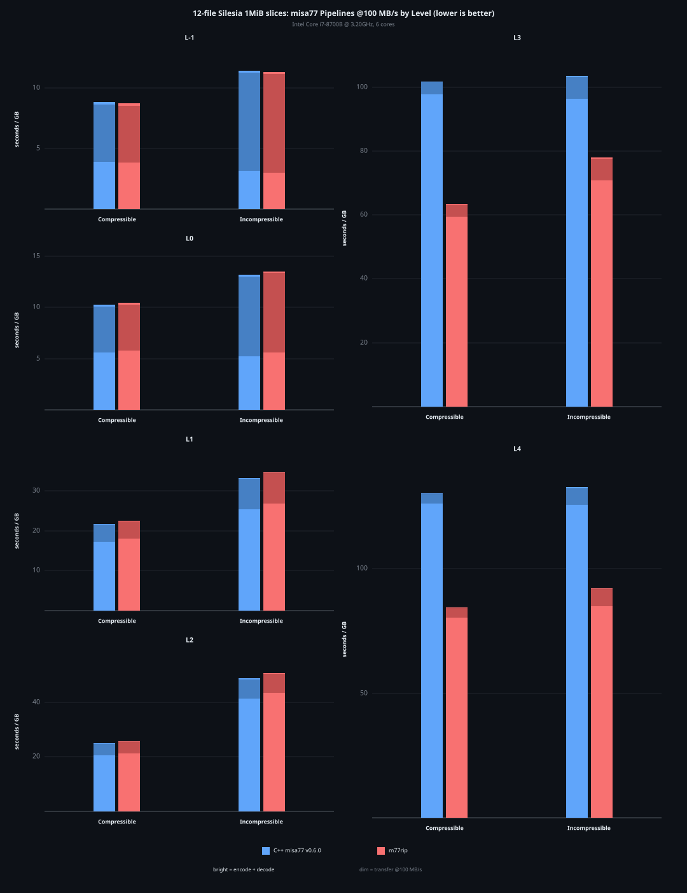

# m77rip

Fast, memory-safe Rust encoder and decoder for the
[misa77](https://github.com/welcome-to-the-sunny-side/misa77) compression
format.

misa77 is an LZ-based codec optimized for write-once, read-many workloads.
It trades compression speed for extremely fast single-threaded decompression
(1.5-2x faster than LZ4) via a split-stream layout that separates control
tokens from literal data.

m77rip is safe Rust: every crate is `#![forbid(unsafe_code)]`. See
[SAFETY.md](SAFETY.md).

## Usage

```rust
use m77rip::{compress, decompress};

let input = b"the quick brown fox jumps over the lazy dog, again and again!";
let compressed = compress(input);
let decompressed = decompress(&compressed, input.len()).unwrap();
assert_eq!(&decompressed, input);
```

For zero-allocation decompression into a caller-provided buffer:

```rust
use m77rip::{compress, decompress_into, decompressed_size};

let compressed = compress(b"hello world, hello world!");
let size = decompressed_size(&compressed).unwrap() as usize;
let mut buf = vec![0u8; size];
let written = decompress_into(&compressed, &mut buf).unwrap();
assert_eq!(written, size);
```

## Feature flags

| Feature | Default | Description |
|---------|---------|-------------|
| `std` | yes | Standard library. Enables runtime SIMD detection and `std::error::Error` impl. |
| `alloc` | yes (via `std`) | Enables `decompress()` which returns a `Vec<u8>`. |
| `paranoid` | no | No effect. Any future `unsafe` code stays out of builds with it. |
| `c-reference` | no | Builds the vendored C++ reference implementation for benchmarking. |

## Performance

Benchmarks use the first 1 MiB from each Silesia file, single-threaded on
x86_64 (AVX2). Best of 10 rounds at 20 ms each. The chart reports
single-threaded pipeline time by level. Lower is better. Tables report
geomeans across all 12 files. Values in parentheses compare against vendored
misa77 v0.6.0 at the same integer level. Encode/decode parentheses are speed
ratios. Compression-ratio parentheses are ratio-vs-ratio values, so higher is
better.



| Level | Encode MB/s (vs misa77) | Decode MB/s (vs misa77) | Ratio (vs misa77) |
|-------|--------------------------|--------------------------|-------------------|
| `-1` | 290 (1.03x) | 5599 (0.94x) | 1.955 (1.00x) |
| `0` | 188 (0.97x) | 6055 (0.94x) | 2.052 (1.00x) |
| `1` | 55.6 (0.95x) | 6708 (0.91x) | 2.169 (1.00x) |
| `2` | 43.1 (0.97x) | 5542 (0.93x) | 2.294 (1.00x) |
| `3` | 16.3 (1.58x) | 5300 (0.91x) | 2.440 (0.99x) |
| `4` | 12.3 (1.55x) | 4362 (0.96x) | 2.525 (1.00x) |

## `no_std` and 32-bit support

The `m77rip-decode` crate supports `no_std` and 32-bit targets. Depend on
it directly with default features disabled:

```toml
[dependencies]
m77rip-decode = { version = "0.1", default-features = false }
```

This gives you `decompress_into` and `decompressed_size`. Add the `alloc`
feature to also get `decompress`.

Without `std`, SIMD dispatch uses compile-time target feature detection
instead of runtime cpuid. Compile with `-C target-cpu=native` or
`-C target-feature=+avx2` to enable AVX2 on x86_64.

The encoder requires `std` and has only been tested on 64-bit targets.

`compress_level` accepts integer levels `-1` through `4`. Levels `-1` through
`3` write light-format streams. Level `4` writes heavy-format streams. Level
`1` is the default.

## License

MIT
